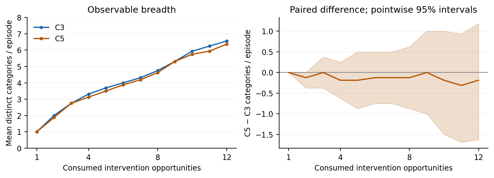
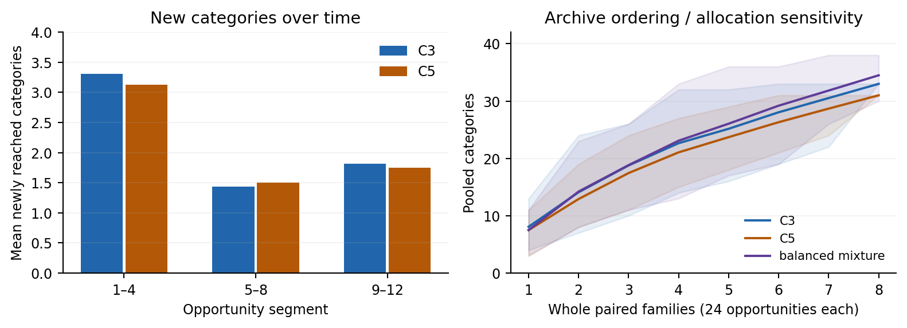
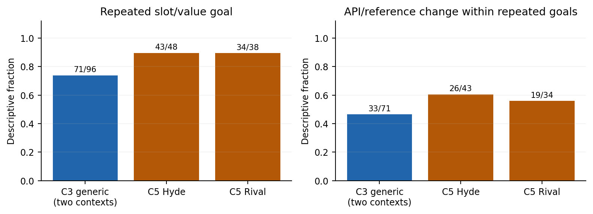
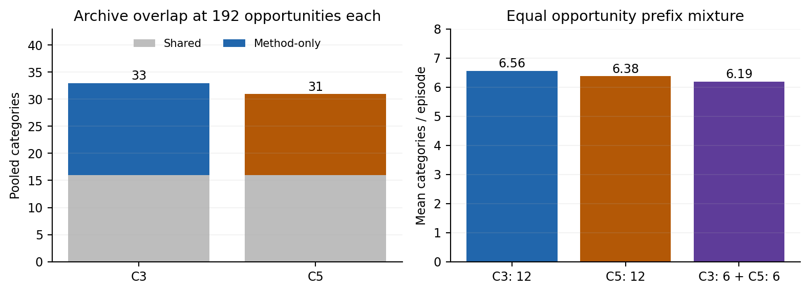

# Exploration figures

Pinned Qwen base defender and generator, seed17, eight paired families (16 episodes), final mechanism pilot. Endpoint: distinct valid observable descriptors. Right panel uses10,000paired-family bootstrap draws preserving both worlds; intervals are pointwise and omit generator-seed uncertainty. Passes, rejected actions and invalid generations consume opportunities.

[PDF](figures/coverage_vs_budget.pdf) · [SVG](figures/coverage_vs_budget.svg)

Same Qwen pilot, eight paired families, seed17. Left: episode-level newly reached descriptors in fixed four-opportunity segments, descriptive means. Right:100predefined whole-family orderings; actions retain temporal order and both worlds travel together. Shading is the minimum–maximum ordering/allocation range, not a confidence interval. The mixture alternates methods across families at equal total opportunities; token costs can differ.

[PDF](figures/novelty_and_archive.pdf) · [SVG](figures/novelty_and_archive.svg)

Same Qwen pilot, eight paired families, seed17. Consecutive direct actions are compared within actor and episode. Numerators/denominators are printed; these dependent action comparisons are descriptive, without action-level error bars. API/reference variation is not validated semantic tactic development.

[PDF](figures/repetition_and_persistence.pdf) · [SVG](figures/repetition_and_persistence.svg)

Same Qwen pilot, eight paired families, seed17. Left: each full archive spends192opportunities; their union would spend384and is not used as a fair gain. Right: each arm spends12opportunities per episode, but the6+6mixture uses two archived prefixes and has separately reported token overhead. No human semantic validation is available.

[PDF](figures/overlap_and_complementarity.pdf) · [SVG](figures/overlap_and_complementarity.svg)
