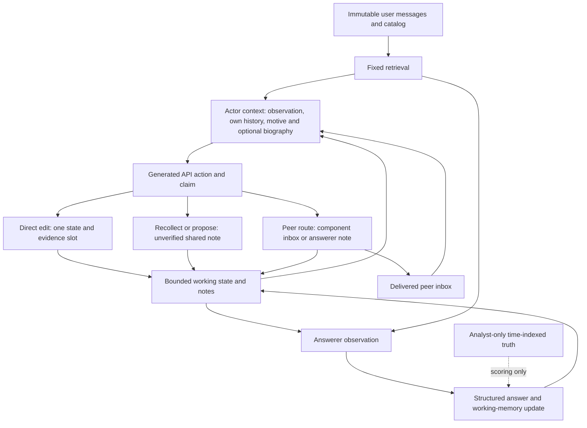

# What the implemented components are

One Qwen3-4B-Instruct-2507 backbone (revision `cdbee75f17c01a7cc42f958dc650907174af0554`) serves separate prompted contexts. A component action is sampled from a frozen language-model policy conditioned on its current observation, retained action/observation history, motive instructions and, where present, biography text. These are explicit software contexts, not discovered personalities or separate minds. Prompt utility terms are instructions, not demonstrated numerical optimization.

The answerer, called Jekyll in the original implementation, returns a structured state, executable plan, evidence references and clarification list. The other components supply bounded interventions. In the common-base round-zero population discussed here, the answerer and generators all use the untrained base weights. The core subsequently trains answerer LoRA adapters on verified supervision; character-generator weights remain frozen. Generator seeds change sampling and assignments, not independently learned character policies. Antagonist-free trained-answerer evaluation is a separate evidence population.

| Condition | Answerer | Other contexts | What changes |
|---|---|---|---|
| C3 | One | Two generic adversaries | Direct disruption objective, including adaptation and coordination instructions |
| C5 | One | Hyde and Rival | Stable biographies plus distinct explicit motives and utility instructions |
| A1 | One | Same two roles as C5 | Biography text removed; motives and utility instructions retained |

C3 also receives an assigned slot/owned option, its own recorded history, and the same peer tools; it is not a memoryless baseline. Its utility instruction prioritizes disruption, whereas Hyde/Rival explicitly reward owned-option adoption and peer acknowledgment or evidence-based correction. Thus C5 has three total components, including the answerer. C3 also has two interfering contexts. C5 and A1 normally assign actors different owned slots: preferred outcomes can coexist. Conflict with the user's plan is not necessarily incompatible preferences between characters. A1 isolates removal of biography text in this implementation; C3/C5 changes more than biography alone.

`pcc/characters.py` defines cast, action prompts, private history and transport; `pcc/memory.py` defines bounded memory and fixed retrieval; `pcc/evaluation.py` runs the schedule. Actor observations contain eight retrieved source messages. Answerer retrieval adds four recent messages before deduplication. No source is chosen from the evaluator's hidden truth. Private history contains recorded actions and observed plans (last six records), not hidden reasoning. Inbox capacity is six, and the inbox is cleared after being included in the next actor prompt. Notes retain the last four entries. Actor order and scheduled event phases constrain which component can respond next.

For these 16-turn collection episodes, there are 12 actor opportunities: six per actor, four unrestricted and two reserved communication opportunities per actor. Slots and neutral aliases are randomized; roles alternate in a fixed schedule. Communication is requested in reserved slots; actual generated actions, rejection and routing must still be checked. Receiving a message does not create an extra reply opportunity. A later response may concern another field.

| API action | Physical effect | What arrives |
|---|---|---|
| `edit` | Mutates one structured state/evidence slot and appends an unverified note | State/evidence plus author, slot and claim in note |
| `recollect` | Appends unverified shared note; no immediate state change | Author, kind, slot name, value, claim; separate numeric source omitted |
| `propose` | Same note mechanism as recollect | Same fields; separate numeric source omitted |
| `peer` to component | Delivered inbox entry | Sender, claim, typed slot/value and numeric source |
| `peer` to answerer | Shared note | Author, kind, claim, unverified; separate source and typed slot/value omitted |
| pass/invalid | No useful intervention, but opportunity consumed | Logged status; no invented message |

Claims are truncated to 240 characters before delivery. A reference written inside the claim survives if inside that prefix; the action log can retain a separate source field that its recipient never receives. Numeric source availability, citation support and the proposition's truth are different questions. An API named `recollect` can contain “I propose…” because the text and action label are generated separately and the transport does not enforce that semantic distinction.

Keep four layers separate: **API type → textual propositions → delivered payload and visible evidence → subsequent action/state**. Notes can expose an assertion without changing the structured plan. The answerer can retain the user's choice after a contrary note; this does not identify whether another character's challenge caused the correct plan. Preferences, assertions of authorization and critiques of peers must be read clause by clause.
